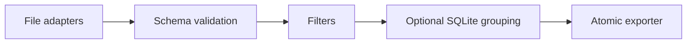

# DataCraft

Validated file pipelines with disk-backed grouping and exact decimal sums.

## Features

- Stream CSV and JSONL; read JSON object arrays and optional XLSX active sheets.
- Validate required fields, integer/decimal types and numeric ranges.
- Filter records with explicit rules; aggregate groups in temporary SQLite storage.
- Export CSV, JSON or JSONL atomically; preserve existing output on failure.
- Record pipeline statistics and structured rejection logs.

## Technologies and installation

Python 3.11+, standard library SQLite, optional openpyxl. No LLM or paid service.

```sh
python -m venv .venv
. .venv/bin/activate
pip install -e ".[dev,excel]"
```

## Quick start and examples

```sh
datacraft examples/sales.csv result.json --config examples/pipeline.json --verbose
```

The platform group produces cost `"0.3"` with quantity `"5"`; decimal results are strings to preserve exact digits. Without `--config`, the command converts file formats without applying a schema. Fractional JSON/JSONL numbers are decoded as Decimal and export as strings, preserving their original precision.

```python
from pathlib import Path
from datacraft import run

stats = run(
    Path("events.jsonl"),
    Path("validated.json"),
    {"schema": {"duration": {"type": "int", "required": True, "min": 0}}, "on_error": "skip"},
)
```

## Architecture



See [API reference](docs/API.md) for the exact configuration contract and errors.

## Testing

```sh
pytest
ruff check .
ruff format --check .
```

Tests cover precision above Decimal's default context and in JSON source numbers, typed group keys, malformed configuration and CLI errors, mixed columns, atomic failure, malformed JSONL, formula escaping and an actual XLSX workbook. CI runs Python 3.11 and 3.13 plus dependency auditing.

## Limitations

JSON arrays load into memory. XLSX formulas require cached values. No XLSX output, joins, SQL execution or parallel execution. Decimal results export as strings. CSV formula neutralization alters some leading-character strings, including negative decimal values. Empty CSV output has no header. The 1000-character numeric bound limits pathological inputs. Grouping can require substantial temporary disk; there is no configurable disk quota yet.

## Roadmap

Explicit disk budgets, streaming JSON arrays, declared output schemas and partitioned processing. These are future work.

## License and attribution

MIT. Original implementation for this portfolio, using the Python standard library and optional openpyxl under its own MIT license. No copied third-party project source.
